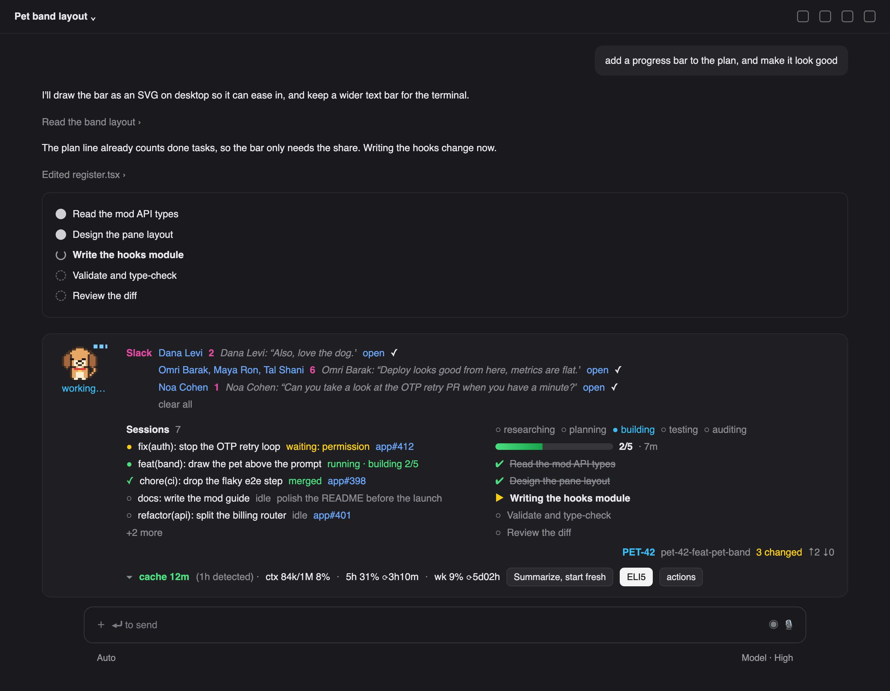
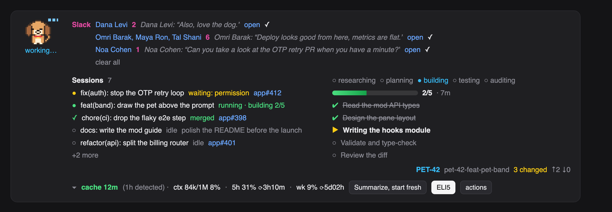
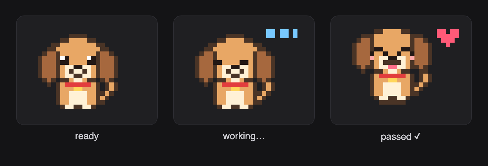

# Bit, the pixel puppy

<p align="center"></p>



<sub>A mock of a running session with `/bit demo` on. Every name, session and message is made up; the dog is the mod's own sprite.</sub>

<details><summary>The band up close</summary>



</details>

A Claude Code mod that draws a 26×18 pixel dog above the prompt. Bit reacts to the session: he works, sleeps, hops when a task passes, droops when a check fails, and asks for you when a tool call waits on permission. Around him the band shows the plan and its progress, the other sessions on this machine, the GitHub and Slack inboxes, the context budget, and one favorite action button.

This file is two guides in one. The first part installs or runs this mod. The second part builds a pet mod from nothing, in four files, so you can make your own.

---

## Part 1 — run this mod

### Install from a marketplace

Type this at the prompt of a terminal Claude Code session:

```
/plugin install pixel-pet --marketplace eranltd/pixel-pet
```

Answer `y` to add the marketplace, then pick the user scope with Enter. The hooks run in that session at once, and in every later session. The desktop app's Code tab cannot run that command, but a mod installed from a terminal at the user scope loads there too.

`eranltd/pixel-pet` is this repository. The `.claude-plugin/marketplace.json` beside the manifest is what makes the repository a marketplace.

### Run from a folder while you change it

Either flag the folder for one session:

```bash
claude --plugin-dir ~/.claude/mods/pixel-pet
```

Or name it for every session, including the ones the desktop app starts, in the `env` block of `~/.claude/settings.json`:

```json
{
  "env": {
    "CLAUDE_CODE_PLUGIN_DIRS": "~/.claude/mods/pixel-pet"
  }
}
```

A terminal session watches the folder and reloads the mod on every save. A desktop session loads it at start and again whenever you type `/reload-plugins` at the prompt, so an edit shows after one reload.

### Bit's moods



He also droops when a check fails, sits up with `needs you` when a tool call waits on permission, and falls asleep after fifteen idle minutes.

### Commands

| Command | What it does |
|---|---|
| `/pet` | Hide or show Bit. |
| `/plan-progress [all\|plan\|demo\|mute\|unmute]` | Open the Plan Progress pane: this session's plan, or every session's. `mute` stops the chime. |
| `/bit recap` · `/bit 1on1 <login>` · `/bit concentration` · `/bit impact <pr>` · `/bit worktrees` · `/bit squad [add\|remove <login>…]` · `/bit slack` | The rituals: a recap of the session, a one-on-one brief, a focus mode, a merge-impact watch, the worktree janitor, the squad list, the Slack connector. |
| `/bit demo` · `/bit demo off` | Fill the band with made-up sessions, Slack messages, a plan and a branch, for screenshots that carry no real names. Nothing is sent anywhere. `off` restores the real data. The desktop app's prompt does not pass mod commands through, so there use the **demo** button in the actions pane; it toggles. |
| `/cache-keeper [ttl <minutes\|auto> \| fresh]` | The context line: status, the cache TTL, or summarize and start a fresh session with the summary in the prompt box. |
| `/critique` | Review Claude's last response in a side pane. |

### The band, top to bottom

```
┌ Bit ──────┐  Sessions 13                      ○ researching ○ planning ● building ○ testing ○ auditing
│  (sprite) │  ● core   running · building      ▓▓▓▓▓▓▓▓▓▓▓▓░░░░░░  2/3 · 7m
│  working… │  ○ feat(front): …  idle  core#1   ✔ Read the code
└───────────┘  ○ chore(tools): …  idle           ▶ Change it
                                                 ○ Test it
                                                 PET-42 my-branch ↑2 ↓0
▾ cache 61m · ctx 283k/1M 28% · 5h 86% ⏱1h52m   [Summarize, start fresh] [ELI5] [actions]
```

- **Bit** sits in the top-left corner with his state under him: `ready`, `working…`, `needs you`, `asleep · 12m idle`, `passed ✓`, `failed ✗`.
- **Sessions** lists every Claude Code session on this machine that runs this mod: the ones waiting on you first, then running, merged, idle. Each row links to its session and its PR.
- **The plan** to the right: the phase dots, a progress bar, one row per task, then the branch line.
- **The ✕** at the top-right hides the band for this session only. A small 🐾 Bit button stays behind to bring it back; other sessions keep theirs.
- **Narrow windows** get a compact layout: the blocks stack, Sessions shows three rows, Slack two, and the plan only its open task.
- **The bottom row**: the collapse caret, a `master CI ✗` flag when it fails, the context and rate-limit line, the favorite action and the `actions` pane button. A Slack row appears above everything when a message waits.

### Check, type-check, test

Use the Claude Code build that runs your sessions. In the desktop app that build is at `$CLAUDE_CODE_EXECPATH`; on a terminal, `claude`.

```bash
claude plugin validate ~/.claude/mods/pixel-pet
claude plugin test ~/.claude/mods/pixel-pet
```

The engine writes `.claude-plugin/types/` into the folder the first time it loads the mod: the API types and a `tsconfig.json` that the mod's own extends. After that, any `tsc` type-checks it:

```bash
tsc -p ~/.claude/mods/pixel-pet
```

That folder is engine-owned and carries its own `.gitignore`, so it never lands in the repository.

---

## Part 2 — build a pet mod from nothing

A mod is a folder with three files, plus a fourth when it keeps state. The engine loads the hooks module in an environment of its own: no DOM, no Node, no `document`, no `fetch`. Everything outside it is reached through `$`, the engine interface each hook receives.

```
my-pet/
├── .claude-plugin/plugin.json   the manifest
├── hooks/hooks.json             names the hooks module
├── hooks/register.tsx           the module: hooks, drawing, commands
└── types/index.d.ts             the state contract
```

The whole mod below is complete. It draws a 12×8 pixel cat above the prompt, animates its tail, and adds `/pet` to hide it. Copy the four files, then run it with `claude --plugin-dir my-pet`.

### 1. The manifest

`.claude-plugin/plugin.json`:

```json
{
  "name": "my-pet",
  "version": "0.1.0",
  "description": "A pixel cat above the prompt",
  "types": "./types/index.d.ts"
}
```

`hooks/hooks.json`:

```json
{ "modules": ["./register.tsx"] }
```

### 2. The state contract

A drawing must read its values from `$.state`, never from a module variable: a hot reload runs the module again and module variables start over, while `$.state` is the host's and stays. Every value is declared under the mod's name.

`types/index.d.ts`:

```ts
declare module 'claude-code' {
  interface PluginState {
    'my-pet': {
      frame: number
      isHidden: boolean
    }
  }
}
```

Keep this file a plain declaration: an `export {}` at its end makes `claude plugin validate` miss the contract.

### 3. The hooks module

`hooks/register.tsx`:

```tsx
import { atom, read, update } from 'claude-code'
import type { Register } from 'claude-code'

// One letter per pixel; '.' is transparent. Two frames: the tail flicks.
const FRAMES = [
  ['..k.....k...', '.kkkkkkkkk..', '.kwkkkkkwk..', '.kkkkpkkkk..', '..kkkkkkkk.k', '..kkkkkkkkk.', '..k.k..k.k..', '............'],
  ['..k.....k...', '.kkkkkkkkk..', '.kwkkkkkwk..', '.kkkkpkkkk..', '..kkkkkkkk..', '..kkkkkkkkkk', '..k.k..k.k..', '............'],
]
const WIDTH = 12
const HEIGHT = 8
const PALETTE: Record<string, number> = { k: 0x3b3b3b, w: 0x9be36d, p: 0xff9eb5 }
const TERMINAL_DEFAULT = 0x01000000
const TICK_MS = 500
const PIXEL_PX = 4

const frameAtom = atom({ plugin: 'my-pet', key: 'frame' } as const, 0)
const hiddenAtom = atom({ plugin: 'my-pet', key: 'isHidden' } as const, false)

function toBase64(bytes: Uint8Array): string {
  const alphabet = 'ABCDEFGHIJKLMNOPQRSTUVWXYZabcdefghijklmnopqrstuvwxyz0123456789+/'
  let out = ''
  for (let i = 0; i < bytes.length; i += 3) {
    const a = bytes[i] ?? 0
    const b = bytes[i + 1] ?? 0
    const c = bytes[i + 2] ?? 0
    const n = (a << 16) | (b << 8) | c
    out += alphabet[(n >> 18) & 63]! + alphabet[(n >> 12) & 63]!
    out += i + 1 < bytes.length ? alphabet[(n >> 6) & 63]! : '='
    out += i + 2 < bytes.length ? alphabet[n & 63]! : '='
  }
  return out
}

// Terminal: one Raster, each cell a half-block glyph so one text row holds two pixel rows.
function toRasterCells(rows: readonly string[]): string {
  const words = new Uint32Array(WIDTH * (HEIGHT / 2) * 3)
  let i = 0
  for (let y = 0; y < HEIGHT; y += 2) {
    for (let x = 0; x < WIDTH; x += 1) {
      const top = PALETTE[rows[y]?.[x] ?? '.']
      const bottom = PALETTE[rows[y + 1]?.[x] ?? '.']
      const [glyph, fg, bg] =
        top === undefined && bottom === undefined
          ? [0x20, TERMINAL_DEFAULT, TERMINAL_DEFAULT]
          : top === undefined
            ? [0x2584, bottom ?? TERMINAL_DEFAULT, TERMINAL_DEFAULT]
            : [0x2580, top, bottom ?? TERMINAL_DEFAULT]
      words[i++] = glyph
      words[i++] = fg
      words[i++] = bg
    }
  }
  return toBase64(new Uint8Array(words.buffer))
}

// Desktop: one SVG, a rect per pixel; SMIL flips the frames so no redraw is needed.
function animatedSvg(): string {
  const dur = `${(FRAMES.length * TICK_MS) / 1000}s`
  const groups = FRAMES.map((rows, tick) => {
    const rects = rows.flatMap((row, y) =>
      row.split('').flatMap((ch, x) => {
        const color = PALETTE[ch]
        return color === undefined ? [] : [`<rect x="${x}" y="${y}" width="1" height="1" fill="#${color.toString(16).padStart(6, '0')}"/>`]
      }),
    )
    const start = tick / FRAMES.length
    const end = (tick + 1) / FRAMES.length
    const [values, keyTimes] = tick === 0 ? ['visible;hidden', `0;${end}`] : ['hidden;visible;hidden', `0;${start};${end}`]
    return `<g visibility="${tick === 0 ? 'visible' : 'hidden'}"><animate attributeName="visibility" values="${values}" keyTimes="${keyTimes}" dur="${dur}" repeatCount="indefinite" calcMode="discrete"/>${rects.join('')}</g>`
  })
  return `<svg xmlns="http://www.w3.org/2000/svg" viewBox="0 0 ${WIDTH} ${HEIGHT}" width="${WIDTH * PIXEL_PX}" height="${HEIGHT * PIXEL_PX}" shape-rendering="crispEdges">${groups.join('')}</svg>`
}

export const register: Register = on => {
  on('session.start', async ($, e, next) => {
    const started = await next(e)
    await $.command.register({ name: 'pet', description: 'Show or hide the pixel cat' })
    // The terminal Raster redraws on each tick; the desktop SVG animates itself.
    $.clock.every(TICK_MS, async () => {
      await update($, frameAtom, frame => (frame + 1) % FRAMES.length)
    })
    return started
  })

  on('command.run', { command: 'pet' }, async $ => {
    const isHidden = await update($, hiddenAtom, hidden => !hidden)
    return { text: isHidden ? 'The cat went for a nap.' : 'The cat is back.' }
  })

  on('ui.render', { component: 'AbovePrompt' }, async ($, e, next) => {
    if (e.props.hasSurvey || (await read($, hiddenAtom))) {
      return next(e)
    }
    let pet
    if (e.surface === 'terminal') {
      const { Raster } = $.ui.resolve(e)
      const frame = await read($, frameAtom)
      pet = <Raster key="pet" columns={WIDTH} rows={HEIGHT / 2} cells={toRasterCells(FRAMES[frame] ?? FRAMES[0]!)} />
    } else if (e.surface === 'desktop') {
      const { Svg } = $.ui.resolve(e)
      pet = <Svg source={animatedSvg()} alt="a pixel cat" width={WIDTH * PIXEL_PX} height={HEIGHT * PIXEL_PX} isInteractive />
    } else {
      return next(e)
    }
    const { Box, Text } = $.ui.resolve(e)
    return (
      <Box flexDirection="row" alignItems="center" columnGap={2}>
        {pet}
        <Text color={e.props.isWorking ? 'cyan' : 'gray'}>{e.props.isWorking ? 'working…' : 'ready'}</Text>
      </Box>
    )
  })
}
```

### How each piece works

**Hooks.** `on(event, matcher?, hook)` adds a hook. Every hook is `($, e, next)`: `$` is the engine interface, `e` the event's frozen input, `next(e)` runs the plugins beneath and then the engine. A hook that returns without `next` answers for itself. `session.start` is where a mod registers commands and starts timers. `command.run` answers a registered command with `{ text }`.

**Drawing.** `ui.render` on `{ component: 'AbovePrompt' }` draws the band above the prompt; return a tree to show it or `next(e)` to show nothing. The elements come from the surface's own table, `$.ui.resolve(e)`, and differ per surface: the terminal has `Raster` and no `Svg`; the desktop the reverse. Narrowing `e.surface` narrows the table. `e.props.isWorking` says whether a turn runs; `e.props.hasSurvey` means the engine draws its own question there, so step aside. Size wide trees to `e.props.bodyColumns`.

**The sprite.** Art is a list of strings, one character per pixel, mapped through a palette of `0x00RRGGBB` colors. On the terminal, a `Raster` packs the whole grid into one base64 string of `[codePoint, fg, bg]` u32 triplets; the half-block glyphs `▀` and `▄` fit two pixel rows into one text row, so a 26×18 dog is 9 rows tall. On the desktop, an `Svg` with SMIL `visibility` animations flips the frames by itself, so a frame change never redraws the band: that matters, because a redraw replaces the buttons under the pointer.

**State.** `atom(ref, initial)` names a value in `$.state`; `read($, atom)` inside a render hook subscribes the drawing, so `update($, atom, fn)` from a timer or another hook redraws it. `$.store` is the same idea across sessions (the mod uses it for the collapsed state, the favorite action, the mute). Declare every atom in the contract, or `claude plugin validate` refuses the module.

**Reacting to the session.** The full mod hooks more events. The ones that drive Bit's poses:

| Event | What Bit does with it |
|---|---|
| `turn.start` / `turn.complete` | working pose; sleeping after a long idle |
| `tool.call` on `mcp__ccd_turn__update_plan` and `TodoWrite` | fills the plan: phases, tasks, the progress bar |
| `tool.call` on `Bash` | classifies pushes, lint and test runs; a pass hops, a failure droops |
| `classic.Notification` | permission waits set the `needs you` pose and a chime |
| `agent.spawn`, backgrounded shells | the `⟳ n in background` count |
| `session.measure` | the context and rate-limit line |

**Other sessions.** Each session writes a small JSON snapshot every five seconds under `~/.claude/plan-progress/sessions/` and reads the others' on each heartbeat. A snapshot older than three heartbeats is a closed or crashed session. The desktop app's own session id comes from the `CLAUDE_CODE_HOST_SESSION_ID` env var, and a `claude://` link built from it opens that session.

**Panes.** `$.ui.open({ id, title })` opens a side pane; a `ui.render` hook on `{ component: 'Pane', requestId: id }` draws it. The mod has four: the plan, the actions, the critique, the worktree janitor.

### Things that bite

- **No font size.** `Text` takes `color`, `dimColor`, `bold`, `italic`, `underline`, `strikethrough` and `wrap`. "Smaller" means dim and compact.
- **No `key` on `Svg`.** The engine drops it; address an `Svg` by its parent `Box`'s key in tests.
- **Tables of closures are refused.** An action table must be data; switch on an id in one named function that receives `$`.
- **Links must be `https:`.** The band refuses anything else. Open a `claude://` link with `$.process.run(['open', link])` instead.
- **Desktop does not reload on save.** A `CLAUDE_CODE_PLUGIN_DIRS` mod reloads in the desktop app when you type `/reload-plugins`; until then the band draws the last loaded version.
- **Module variables reset** on every reload. Keep drawn values in `$.state`.
- **A tree that fails validation is replaced** by the engine's own drawing, with one dim transcript line saying why while the folder hot-reloads, and a debug-log line always.

### Tests

`claude plugin test <folder>` runs every `tests/*.test.tsx`. A test mounts a component and asserts on the tree:

```tsx
import { expect, mock, test } from 'claude-code/testing'

test('the cat draws above the prompt and /pet hides it', async ($, on) => {
  mock.clock(on, { now: 1_800_000_000_000 })
  mock.store(on)
  const props = { hasSurvey: false, isWorking: false, maxRows: 20, bodyColumns: 120, scroll: { bodyRows: 20, offset: 0 }, view: {} } as never
  const ui = await $.ui.mount({ plugin: 'my-pet', surface: 'terminal', component: 'AbovePrompt', props })
  expect(await ui.find({ key: 'pet' })).toBeDefined()
  expect(await ui.find({ text: /^ready$/ })).toBeDefined()
  await ui.unmount()
})
```

### Share it

Add `.claude-plugin/marketplace.json` beside the manifest, with the mod's folder as its one entry:

```json
{
  "name": "my-pet",
  "owner": { "name": "<you>" },
  "plugins": [{ "name": "my-pet", "source": "./" }]
}
```

Push the folder to GitHub. Anyone then installs it with:

```
/plugin install my-pet --marketplace <owner>/<repo>
```
